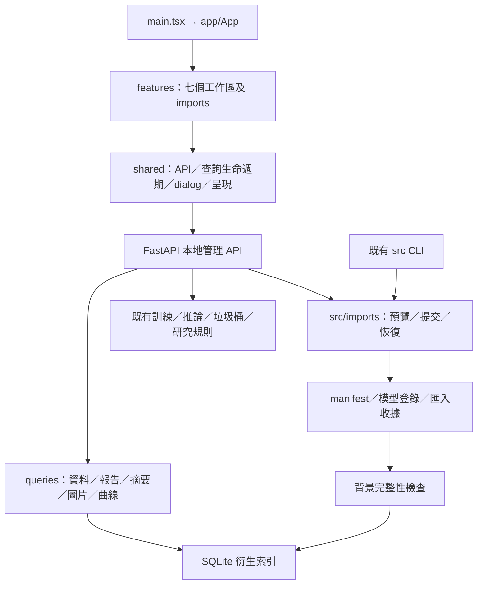

# 效能、資料夾與安全匯入

本輪保留 YOLO 版本、正式研究資料、不可變快照及 local／LINE 引用。匯入不會自動訓練或啟用模型。

## 啟動與目錄

在專案根目錄的 VS Code PowerShell 執行：

```powershell
.\.venv\Scripts\python.exe -m src workbench --port 8765
```

開啟 `http://127.0.0.1:8765`。若連接埠已占用，先使用已啟動的服務，或明確改用其他埠。前端開發代理仍指向 8765；正式內建網頁使用同一 FastAPI 服務。

| 目錄 | 責任／人工操作 | 保存與重建 |
|---|---|---|
| `src/`、`web/src/` | 程式；前端分成 app、shared、features | 納入版本控制，原平面 TSX 保留相容匯出 |
| `data/` | manifest、圖片、標註、審查、匯入來源、不可變快照 | 勿直接塞照片或編輯歷史快照；正式來源不可視為快取 |
| `models/` | 官方基礎權重、不可變版本、模型引用 | 推論與 checkpoint 用途分開；正式版本沿用垃圾桶 |
| `runs/` | 工作與評估結果 | 原路徑不搬動，報告保留來源追溯 |
| `inbox/photos/<批次>/` | 人工放照片及候選標註 | 匯入成功仍保留來源；未納入垃圾桶永久刪除範圍 |
| `inbox/models/<模型包>/` | 人工放模型包與 package.json | 不執行包內程式，不自動覆寫／啟用 |
| `runtime/imports/` | 暫存、收據、官方來源摘要 | 日誌是恢復依據，不可手動修改；來源與正式複本可能同時占空間 |
| `runtime/cache/` | 圖片等衍生快取 | 可重建，圖片容量預設 1 GiB |
| `runtime/workbench/` | SQLite、管理狀態與備份 | 勿刪除資料庫、WAL、SHM；不自動 VACUUM |
| `archive/` | 歷史原始封存 | 本輪不搬動或清理 |

## 照片匯入

### 程式依賴與責任



原本 `main.tsx` 同時承擔所有頁面；現在只啟動 App，頁面移至 `features/`，舊平面檔案保留 re-export。後端 `api.py` 保留既有管理入口，本輪新增 `routes/imports.py` 及 `queries/`，權威資料操作仍由既有 data、registry、jobs、lifecycle 負責。

1. 在 `inbox/photos/研究批次/` 完成照片複製，再開啟資料審查的「匯入照片」。
2. 選擇批次，按「掃描並預覽」。支援 JPEG／PNG／WEBP、同名 LabelMe JSON／YOLO TXT；單張上限 50 MiB、2500 萬像素、至少 64 px，每批最多 1000 個檔案。
3. 核對新增／重複略過／拒絕項目與空間需求。損毀圖片不進入正式資料；同內容去重，同名不同內容配置不同 image_id。
4. 輸入「確認匯入」並提交。可關閉視窗，透過「最近匯入紀錄與恢復」查看相同操作。
5. 新照片只進入待人工審查，標籤未知、分組未確認。候選標註保存在獨立區域；方向不明時要求人工核對，不自動形成正式標註。
6. 審查通過後，另行建立新的資料快照。舊實驗不會自動加入這些照片。

CLI 使用同一服務：

```powershell
.\.venv\Scripts\python.exe -m src imports scan --kind photos --batch 研究批次
.\.venv\Scripts\python.exe -m src imports commit --id <預覽ID> --key <固定冪等鍵>
.\.venv\Scripts\python.exe -m src imports status --id <操作ID>
.\.venv\Scripts\python.exe -m src imports status --id <操作ID> --page 2 --size 30
.\.venv\Scripts\python.exe -m src imports retry --id <操作ID> --key <原冪等鍵>
```

網頁預覽綁定管理會話，CLI 預覽使用 CLI 會話；不要交叉提交。預覽有效 5 分鐘。來源變動後需重新掃描；提交後的重試只恢復原清單，不擴張範圍。磁碟不足或中斷不會讓半完成批次取得訓練資格。

原圖逐位元保留；不從檔名推測疾病、病人或訓練分組。原檔不會自動刪除。收據位於 `runtime/imports/receipts/`，正式來源資訊位於 `data/imports/`。確認收據及正式複本後，可自行在檔案總管管理 inbox 來源；這不是系統垃圾桶操作。

成功後只清理本次清單可證明歸屬的暫存複本，逐檔檢查身分與雜湊；清理失敗保留警告與暫存，不刪來源、正式圖片或登錄版本。模型匯入會保留來源訓練快照／設定的追溯，避免後續評估誤用新的資料切分。

## 模型包

首版只信任本專案可追溯產物／工作，以及服務端核對過的官方權重。不接受 ZIP、自訂載入程式或僅以副檔名聲稱安全的未知 `.pt`。

`inbox/models/<模型包>/package.json` 範例（此為輸入規格，不是介面原始 JSON 呈現）：

```json
{
  "schema_version": 1,
  "purpose": "inference",
  "model": "yolo11n",
  "source": {"type": "project_artifact", "id": "既有模型版本ID"},
  "files": {"best.pt": "來源 artifact.json 記錄的 SHA-256"},
  "config": {"與來源模型完整相同的推論設定": "請使用來源原始設定"}
}
```

`files` 必須完整符合來源的實際產物清單，`config` 必須是來源完整推論設定；上述占位值不能直接匯入。系統同時核對服務端來源與實際檔案，不把包內自行宣告的雜湊當成信任證據。

| 用途 | 來源與條件 | 匯入後使用 |
|---|---|---|
| `inference` | `project_artifact`，正常使用狀態的登錄版本（不要求目前啟用），內容與設定相同 | 新不可變版本，未評估、未啟用；重新評估後另行切換 |
| `base` | `official`，files 符合服務端官方準備工作保存的可信摘要 | 放入受保護基礎權重區；建立實驗時明確選擇 |
| `checkpoint` | `project_job`，原工作、設定、快照仍有效，完整續訓檔案符合來源 | 登錄為 checkpoint 用途；可明確提交原參數續訓，不能啟用為推論模型 |

YOLO checkpoint 必須包含 `training/weights/last.pt`、`training/weights/best.pt`、`experiment.json`、`effective.json`。EfficientNet 必須包含 `last.pt`、`artifact/model.pt`、`experiment.json`、`effective.json`。存在 checkpoint 選取紀錄時也應包含。DINO 維持重新擬合，不支援 checkpoint 續訓。

首次沒有官方可信摘要時，在模型目錄明確執行「核對官方權重來源」。該操作會以背景準備工作從現有固定官方來源重新取得內容，不覆寫不同內容的舊權重。離線且無可信摘要時拒絕匯入；本輪驗收不下載或載入真實模型。

照片／模型 CLI 相同，將 scan 的 kind 改為 `models`。模型匯入不採用 LINE 附件的一小時／30 天保存政策。

## 查詢、快取與一致性

權威來源仍是 manifest、審查歷史、快照與模型／報告檔案。SQLite 資料與報告索引是可重建投影；新 schema 版本為 3，採加法遷移並保留 audit AUTOINCREMENT 與垃圾桶日誌。

- 清單 GET 不重新雜湊全部照片。SQLite 執行資料篩選、計數、排序與分頁。
- 啟動／每 30 秒背景核對檔案 stat；每天完整驗證。資料審查可手動「重新檢查」。同一索引有跨程序鎖，不因多個 GET 重複執行完整檢查。
- mtime／size 只用於失效偵測。刻意保留 stat 的外部改檔可能到內容檢查才被發現；快照、訓練、模型載入／啟用與刪除仍核對實際來源。
- 未檢查、過期、檢查失敗不授予新的訓練資格。醫院確認圖片不增加「舊資料／人工審查未紀錄」標籤。
- 圖片轉換使用 320 px 縮圖／1800 px 主圖，EXIF 校正後與標註對齊；瀏覽器維持 no-store，未改為公共長期快取。
- 圖片來源移除或撤回後，快取不能提供可存取替代。撤回流程同步清除衍生圖片。
- 歷史曲線來源背景索引；逐 epoch 檔案增量讀取，半行暫不接受、截斷與替換後重建。原始數值不被平滑曲線覆蓋。
- GET 逾時 15 秒；暫時性錯誤最多額外重試兩次。修改請求不自動重送，逾時需先查詢操作狀態。

## API 與維護

新增 `/imports/batches`、`/imports/previews`、`/imports/operations` 與各 ID 明細／retry；packages 提供基礎權重及 checkpoint 選項。`/jobs-query` 為分頁摘要，`/jobs/{id}/log` 支援 offset／limit。`/data-index` 顯示檢查狀態，`POST /data-index/rebuild` 明確重建。

`/snapshot-options` 回傳 fold 數量與選项，不傳全部成員；`/cases-query`、`/simulation-query` 後端分頁。工作詳情 `details=false` 不讀日誌；展開日誌才取得有大小限制的尾端。舊 API 預設行為保留。

### 索引及圖片快取重建

- 資料：使用資料審查的「重新檢查」，或先取得管理會話後以 CSRF 呼叫重建端點；CLI 匯入會自動失效／重建。
- 報告：檔案 stat 與索引不同時重新解析；原始報告不修改。歷史曲線來源啟動時及背景重新列舉。
- 圖片：缺少衍生快取即重建，容量管理只清理 `runtime/cache/images/`。停止服務後可移除此目錄的生成 JPG；不要清理 imports、資料庫或原圖。
- 無需搬動正式根目錄；Windows 啟動腳本仍使用原 CLI。SQLite v2、v3 遷移各保存一致性備份，已遷移連線只讀版本，不重做 DDL。

舊 `/jobs`、報告匯出、模型下載與 CLI 保留。所有新增 API 都在 `/api/v1` 本地管理服務下，沿用 Host／Origin、CSRF 與操作者規則；不掛載於公開 LINE webhook。

執行前程式與 SQLite 備份位於 `runtime/code_backups/performance-imports-20261002-221129/`。回退程式前先停止服務；有新匯入後不可直接覆蓋舊資料庫，必須保留正式圖片、版本與收據。索引是衍生資料，但 imports／垃圾桶／audit 表不是可任意丟棄的快取。

## 驗證

Python：`python -m pytest -q`；前端：`npm --prefix web run build`。

瀏覽器腳本只允許隔離 fixture 8877／8878：`web/workbench-regression.mjs`、`web/trash-regression.mjs`、`web/import-regression.mjs`、`web/performance-check.mjs`。不得把破壞性或匯入測試改指向正式服務。

量測、測試與未驗證限制另記錄於 `docs/PERFORMANCE_RESULTS.md`；不以單元測試通過代替畫面驗證。
