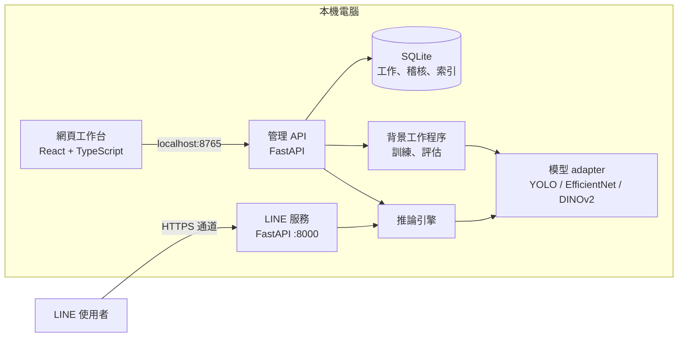
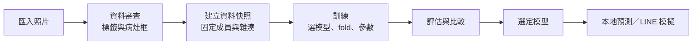

# Phlebitis 靜脈炎影像研究工作台

以手機照片輔助觀察**周邊靜脈注射部位靜脈炎**的研究原型。系統在本機電腦上完成照片審查、標註、模型訓練、評估與比較，並提供 LINE 聊天機器人的離線模擬與正式介面。

> [!IMPORTANT]
> 本系統是**研究原型，不是醫療器材**。模型結果不代表疾病診斷，也不提供嚴重度分級；未偵測到病灶也不能排除靜脈炎。目前模型辨識效果**尚未達實用要求**（詳見[目前狀態與限制](#目前狀態與限制)）。

> [!NOTE]
> 本倉庫**不含任何病患照片、標註、模型權重或訓練結果**，只有程式碼與文字文件。詳見[隱私](#隱私)。

---

## 目錄

- [專案背景](#專案背景)
- [功能概覽](#功能概覽)
- [系統架構](#系統架構)
- [資料夾結構](#資料夾結構)
- [安裝與啟動](#安裝與啟動)
- [使用流程](#使用流程)
- [支援的模型](#支援的模型)
- [資料管理原則](#資料管理原則)
- [評估方式](#評估方式)
- [LINE 聊天機器人](#line-聊天機器人)
- [命令列工具](#命令列工具)
- [測試](#測試)
- [目前狀態與限制](#目前狀態與限制)
- [版本歷程](#版本歷程)
- [隱私](#隱私)
- [延伸文件](#延伸文件)

---

## 專案背景

靜脈炎是周邊靜脈留置針常見的併發症，臨床上多以目視觀察紅、腫、硬結等表現來判斷分期。本專案想了解：**以手機拍攝的注射部位照片，能否由電腦視覺模型協助標示疑似病灶**，作為護理觀察的輔助參考。

專案從幾支 YOLO 訓練腳本開始（`v0-original`），逐步發展成完整的本地研究工作台。重點不只是「訓練出一個模型」，而是讓研究流程**可追溯、可重現、不誤用資料**：

- 每張照片都要經過人工審查，才能進入訓練。
- 每次訓練使用固定的資料快照，事後可以查出當時用了哪些照片與標註。
- 評估指標分開呈現，不把單一分數包裝成「準確率」或「疾病機率」。

## 功能概覽

工作台是在本機瀏覽器操作的網頁介面（`http://127.0.0.1:8765`），共有七個區塊：

| 區塊 | 用途 |
|---|---|
| **總覽** | 資料分類統計、已核對個案數、目前背景工作狀態 |
| **資料審查** | 檢視照片（已校正 EXIF 方向）、畫或修改病灶框、確認正常／第一期／第二期標籤、記錄審查者與原因；分成「影像分類」與「病灶偵測」兩條獨立流程 |
| **模型與實驗** | 模型目錄、建立資料快照、設定並啟動訓練、監看工作、評估比較、模型版本、訓練曲線 |
| **LINE 模擬** | 以 iOS／Android 樣式模擬 LINE 對話，傳文字或照片給模型；完全離線，不會發送真實訊息 |
| **LINE 研究收件** | 管理經使用者同意而收到的照片：同意紀錄、保存期限、撤回 |
| **設定與維護** | 操作者、運算鎖與 GPU 狀態、到期清理預覽、模型引用、操作稽核 |
| **垃圾桶** | 工作、模型版本與稽核紀錄的移入／還原、永久刪除前預覽、中斷後恢復 |

另外也提供：

- **本地預測**：雙擊 `啟動本地預測.cmd` 選一張照片，輸出框選圖與 JSON 結果。
- **LINE Bot 服務**：接收 LINE 傳來的照片並回覆分析結果（需自行設定 LINE 帳號與 HTTPS）。
- **照片／模型包匯入**：放進 `inbox/` 後在網頁上預覽確認，不會自動處理。

## 系統架構



設計重點：

- **管理介面與公開入口分離**：管理 API 只監聽 `127.0.0.1:8765`；LINE 服務在另一個 port（8000），無法存取管理資料或控制 API。
- **一次只跑一個模型運算**：訓練、評估、LINE 推論共用全機運算鎖，避免 GPU 記憶體衝突。
- **長工作是獨立背景程序**：重新整理網頁或重啟工作台不會中斷訓練或重複啟動；停止時先要求程序自行結束，超過 30 秒才強制終止。
- **檔案位置由 `workspace-layout.json` 決定**：程式不依賴啟動時的工作目錄。

### 技術堆疊

| 層 | 技術 |
|---|---|
| 後端 | Python 3.12、FastAPI、Uvicorn、SQLite |
| 模型 | Ultralytics YOLO 8.4、PyTorch（CUDA）、Hugging Face Transformers、scikit-learn |
| 前端 | React 19、TypeScript、Vite |
| 測試 | pytest、Playwright |
| 執行環境 | Windows、NVIDIA GPU（無 GPU 時可改用 CPU） |

## 資料夾結構

工作區分成三區，對應 `workspace-layout.json`：

```
Phlebitis/
├── start.bat / stop.bat / setup.bat   啟動、停止、安裝
├── workspace-layout.json              三個區域的位置
├── .env.example                       LINE 金鑰範本
├── 01_文件與紀錄/                       操作手冊、驗收紀錄、研究報告
├── 02_主程式碼/                         程式碼
│   ├── src/
│   │   ├── data/          照片來源、標註轉換、檔名規則、資料快照
│   │   ├── training/      訓練、續訓、選定模型
│   │   ├── inference/     圖片解碼、方向校正、推論與結果格式
│   │   ├── line_bot/      LINE 簽章驗證、訊息、選單、排隊
│   │   ├── imports/       照片與模型包匯入
│   │   └── workbench/     管理 API、模型 adapter、背景工作、評估、垃圾桶
│   ├── web/               React 前端
│   ├── tests/             自動測試
│   ├── scripts/           Windows 安裝與啟動腳本
│   └── configs/           訓練、服務、匯入來源、研究同意設定
└── 03_模型與影像資料/                    ⚠ 不在本倉庫（含病患資料）
    ├── data/       照片、標註、資料快照
    ├── models/     預訓練與訓練後權重
    ├── runs/       訓練與評估輸出
    ├── runtime/    資料庫、暫存、程式鎖
    ├── inbox/      待匯入的照片與模型包
    └── archive/    原始資料與舊版程式封存
```

各子資料夾的說明見 `02_主程式碼/src/*/README.md`。

## 安裝與啟動

### 需求

- Windows 10／11
- Python 3.12
- Node.js 22 以上（只在安裝時建置前端；日常啟動不需要）
- NVIDIA GPU 與驅動（建議；沒有 GPU 也能以 CPU 執行，但訓練很慢）

### 安裝

```powershell
git clone https://github.com/chenpin12345/Phlebitis.git
cd Phlebitis
.\setup.bat
```

`setup.bat` 會在 `02_主程式碼/.venv` 建立 Python 環境、安裝 PyTorch（CUDA 版）與相依套件，並建置網頁前端。沒有 NVIDIA GPU 時改用：

```powershell
powershell -NoProfile -ExecutionPolicy Bypass -File .\02_主程式碼\scripts\setup-workbench.ps1 -CpuOnly
```

### 啟動

雙擊 `start.bat`，再用瀏覽器開啟 `http://127.0.0.1:8765`；要停止時雙擊 `stop.bat`。

開啟網頁不會自動訓練、切換模型或傳送 LINE 訊息。

> [!TIP]
> 由於本倉庫不含資料，第一次啟動時工作台是空的。請將自己的照片放入 `03_模型與影像資料/inbox/photos/<批次名稱>/`，再從網頁的匯入功能預覽並確認。

## 使用流程



1. **匯入照片**：放進 `inbox/photos/`，在網頁上預覽後確認匯入。
2. **資料審查**：逐張確認標籤（正常、第一期、第二期），偵測任務需框出病灶。正常照片不可有框，陽性照片必須有框。
3. **建立快照**：快照會固定當下的照片、標註、個案分組與雜湊，預設切成三折。
4. **訓練**：手動選模型、fold、GPU／CPU 與參數；可一次排入最多五種模型依序比較。
5. **評估**：訓練完成的模型會登錄為候選，再排入評估；未評估前不顯示任何分數。
6. **選定與使用**：明確選定後，才能用於本地預測或 LINE。

## 支援的模型

| 模型 | 類型 | 訓練策略 |
|---|---|---|
| YOLO11n | 病灶偵測 | 官方預訓練權重微調；最多 120 輪，連續 25 輪未改善提早停止（基線模型） |
| YOLO11s | 病灶偵測 | 同上，較大的模型 |
| YOLO26s | 病灶偵測 | 官方 YOLO26s；可選 NMS 或端到端推論 |
| EfficientNet-B0 | 影像分類 | 凍結主幹只訓練分類頭，可選擇解凍最後階段；最多 20 輪 |
| DINOv2 ViT-S/14 | 影像分類 | 凍結的官方 backbone 取 384 維特徵，只擬合 logistic regression |

分類任務分為二分類（正常／異常）與分期（正常／第一期／第二期）。YOLO 訓練參數見 `02_主程式碼/configs/train.json`。

## 資料管理原則

| 位置 | 意義 | 可否訓練 |
|---|---|---|
| `data/approved` | 人工確認可用的照片與標註 | ✅ |
| `data/pending_review` | 缺標註、來源待查或疑似重複 | ❌ |
| `data/excluded` | 模糊、無法判讀或損壞 | ❌ |
| `data/yolo/<版本>` | 不可變的資料快照 | 訓練輸入 |
| `data/independent_test` | 預留的外部測試資料 | ❌（只用於最終測試） |

- **同一個案的照片不會被拆到訓練與驗證兩邊**，避免資料洩漏造成分數虛高。
- **個案身分尚未經資料提供者確認前**，只能以「研究展示模式」（`--demo`）訓練，評估結果不能宣稱可泛化到新病人。
- 修改備註不影響快照；修改標註或個案分組時，舊快照會被標記為「不適用」但仍保留可追溯。
- 快照中的圖片或標註被竄改時，完整性檢查會拒絕訓練。
- 多人同時審查時以 revision 檢查與單一寫入鎖避免覆蓋。

## 評估方式

- **影像準確率** = (TP + TN) / (TP + TN + FP + FN)，並附上「正確張數／有效張數」。
- Precision、Recall、Specificity、F1、Balanced Accuracy、正常照片誤報率、多數類基準分開顯示；分母為零時顯示 N/A。
- 偵測模型的 AP 與影像層級的二元判斷分開計算。
- 有照片缺失或推論失敗時，報告會標示為不完整，不與完整報告排名。
- 單張照片的模型分數**不是**準確率、疾病機率或嚴重度。
- 比較畫面中，金色框為人工標註，青綠色框為模型預測。

## LINE 聊天機器人

使用者在 LINE 上傳注射部位照片，系統回覆框選結果。對使用者只顯示「疑似」或「未達門檻」，不顯示分期或嚴重度。

- 框選結果圖片以一次性網址提供，**一小時後失效**。
- 研究用途的照片保存需先取得使用者同意，並可撤回（見 `RESEARCH_INTAKE.md`）。
- 服務只監聽本機 `127.0.0.1:8000`，需另外架設 HTTPS 通道（例如 Cloudflare Tunnel 或 ngrok）才能接收 LINE webhook。
- 未設定金鑰時服務會拒絕啟動。

設定方式：

1. 複製 `.env.example` 為 `.env`，填入 LINE Channel secret 與 access token。
2. 依 `01_文件與紀錄/操作與交付說明/LINE.md` 設定 HTTPS 與 webhook。
3. 在 `02_主程式碼` 執行 `.\.venv\Scripts\python.exe -m src serve`。

> [!WARNING]
> 照片經過 LINE 平台傳送。若院方要求影像留在內網，應改用內網上傳入口。

## 命令列工具

在 `02_主程式碼` 資料夾中執行。指令中的 `data/...`、`runs/...` 等相對路徑都以 `03_模型與影像資料` 為準。

```powershell
.\.venv\Scripts\python.exe -m src doctor        # 檢查 Python、CUDA、套件
.\.venv\Scripts\python.exe -m src audit         # 檢查資料完整性
.\.venv\Scripts\python.exe -m src build --demo  # 建立三折資料快照
.\.venv\Scripts\python.exe -m src train --demo  # 訓練 YOLO 基線
.\.venv\Scripts\python.exe -m src evaluate      # 評估
.\.venv\Scripts\python.exe -m src select        # 選定模型
.\.venv\Scripts\python.exe -m src predict "照片.jpg" --allow-demo  # 分析單張照片
.\.venv\Scripts\python.exe -m src serve         # 啟動 LINE 服務
.\.venv\Scripts\python.exe -m src workbench --port 8765  # 啟動工作台
```

完整說明：`.\.venv\Scripts\python.exe -m src --help`

## 測試

```powershell
cd 02_主程式碼
.\.venv\Scripts\python.exe -m pytest -q
```

自動測試涵蓋資料隔離、快照完整性、背景工作、垃圾桶、LINE 流程與錯誤處理，共 179 項。測試使用合成圖片與模擬 LINE，不需要真實資料，也不會傳送真實訊息。

## 目前狀態與限制

- **模型效能尚未達實用要求**：資料量仍小，原選定的 YOLO11n 在單一 fold 驗證中漏掉 4 張病灶照片，3 張正常照片中有 1 張誤報。
- 個案分組仍待資料提供者確認，所以目前的訓練與評估都屬於研究展示。
- 沒有嚴重度分級模型；不能把 YOLO 信心分數換算成嚴重度。
- 沒有自動病人識別、醫院系統（NIS／FHIR）串接、熱像融合，也沒有正式上線認證。
- 管理介面沒有登入驗證，操作者名稱為自行填寫，只適合單機使用。
- 真實 LINE 帳號與手機端驗收尚未完成。

## 版本歷程

每個版本都有對應的 tag，可在 GitHub 的 [Tags](https://github.com/chenpin12345/Phlebitis/tags) 頁面瀏覽或下載。

| Tag | 日期 | 內容 |
|---|---|---|
| `v0-original` | 2026-06 | 最初的 YOLO 訓練與推論腳本 |
| `v1` | 2026-09-28 | 研究工作台第一版：FastAPI 後端、React 前端、LINE Bot |
| `v2` | 2026-09-30 | 工作台擴充：資料審查、模型比較、監控、維護、垃圾桶 |
| `v3` | 2026-10-03 | 前後端依功能分區重構、照片／模型匯入、效能量測 |
| `v4` | 2026-10-14 | 工作區分成 01／02／03 三區（目前版本） |

## 隱私

本倉庫只包含程式碼與文字文件，下列內容**沒有上傳**：

- 病患照片、標註、資料快照（`03_模型與影像資料/`）
- 模型權重、訓練輸出、資料庫
- 含病患照片的截圖、原成果報告（.docx）
- LINE 金鑰（`.env`）

文件與測試中提到的影像檔名都已去識別化：拍攝日期改為 `202601xx`，床號改為 `BEDxx`，合作醫院名稱與本機路徑也已移除。`.gitignore` 預設排除所有影像、模型與資料檔。

## 延伸文件

| 文件 | 內容 |
|---|---|
| [文件索引](01_文件與紀錄/INDEX.md) | 所有文件的入口 |
| [交接與架構](01_文件與紀錄/操作與交付說明/HANDOVER.md) | 接手人員先讀：模組責任、對外介面、常見問題 |
| [工作台手冊](01_文件與紀錄/操作與交付說明/WORKBENCH.md) | 各功能、訓練參數、保存政策 |
| [資料管理](01_文件與紀錄/操作與交付說明/DATA.md) | 兩條審查流程、檔名規則、補入照片 |
| [訓練與評估](01_文件與紀錄/操作與交付說明/TRAINING.md) | 快照、模型、指標判讀 |
| [LINE 操作](01_文件與紀錄/操作與交付說明/LINE.md) | 金鑰、HTTPS、圖文選單 |
| [LINE 研究收件](01_文件與紀錄/操作與交付說明/RESEARCH_INTAKE.md) | 同意、保存、撤回 |
| [程式碼說明](02_主程式碼/README.md) | 程式碼區的詳細說明 |
| [工作台驗收紀錄](01_文件與紀錄/驗證報告/WORKBENCH_ACCEPTANCE.md) | 實際驗收結果 |
